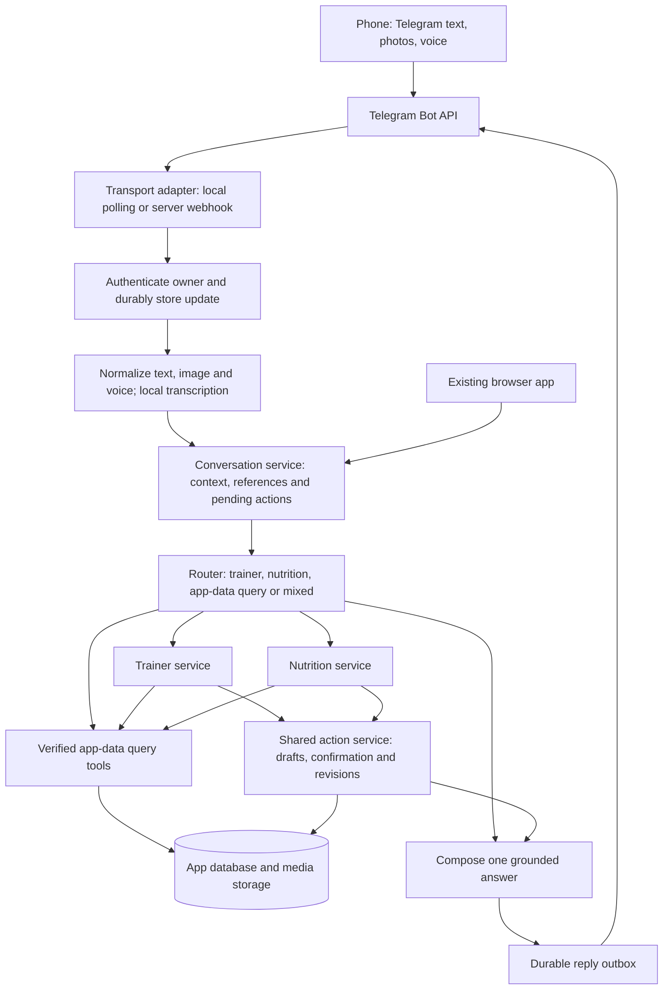

# Telegram nutrition and trainer access — implementation plan

Created: 23 October 2026 (Asia/Jerusalem). Status: **planned; no implementation, bot registration, credentials, deployment or external messages performed.**

## 1. Outcome and scope

One private Telegram bot provides phone access to the same nutrition assistant, trainer and verified application data used by the browser app. Send text, meal pictures, screenshots and recorded voice messages; receive conversational answers, food drafts and actionable proposals in the same chat. Routing should be automatic, with an easy manual correction. The system initially runs on the user's computer and can later move to a server without replacing its business logic or losing history.

Voice means asynchronous recorded voice messages in the first version. Live telephone-style conversation and spoken replies are separate later capabilities. Text replies to voice are sufficient initially. Telegram is the selected messaging channel; WhatsApp is not required.

The user's preceding requirement is a dependency: the trainer must be able to answer questions about **all user-facing data in the app**, not merely the small context bundled with a training suggestion. This includes Garmin-derived history and locally entered nutrition, goals, plans, feedback and equipment records. Access means queryable through appropriate services, not dumping all records into every prompt. Credentials, authentication tokens and private application internals are excluded.

## 2. Block architecture

Both deployment modes feed the same normalized message contract and use the same conversation, tool, action and reply services. Domain services must not import Telegram SDK types. Keep the current browser endpoints backward compatible during extraction.

## 3. Existing implementation to reuse and gaps

| Existing surface | Planned reuse / required change |
|---|---|
| `backend/app/ai_chat.py`, `/api/ai/chat` | Extract/adapt a transport-independent trainer invocation and structured response events from the current streaming route. Retain actual conversation/tool context; do not make a second trainer implementation. |
| `backend/app/ai_tools.py` | Inventory current tools against every user-facing dataset; add missing read capabilities and date/sport/section selection. Keep write tools separate. |
| `backend/app/nutrition_chat.py`, `/api/nutrition/chat` | Reuse nutrition conversation and pending food/target state; persist state currently supplied by callers. Respect existing context bounds with durable references and summaries. |
| `backend/app/food_vision.py`, `/api/nutrition/photo` | Reuse photo validation/analysis and reviewed estimates. Current validation accepts bounded PNG/JPEG images; normalize Telegram images to that contract. |
| `backend/app/nutrition.py` | Reuse meal preview/save, revision history and operation IDs; one database for browser and phone. |
| Training adjustment / publication services | Reuse domain proposals and revision checks. Respect later agreed automatic Garmin-sync policy; do not duplicate publication policy in the bot. |
| `backend/app/ai_providers.py` | Keep configured provider selection. Add an independent speech-to-text capability interface and media-capability checks; no silent paid fallback. |
| Launcher and SQLite | Add an optional managed bot worker, durable inbox/outbox and a single-consumer lease. No background/autostart installation as part of this planning task. |

These are integration points inspected in the repository, not a claim that they already support Telegram, durable cross-channel conversations or voice.

## 4. Complete application-data access

Build a coverage matrix before promising complete access. For each dataset list storage/service, dates, units, source, freshness, query tool, trainer availability and an example acceptance question. Cover:

- Activities, summaries, laps, streams and user-requested sections; route/ride comparisons.
- Sleep, HRV, RHR, stress, Body Battery, steps, energy, weight/body composition, hydration and other available health series.
- Training load and personalized ranges, load focus, cycling ability where available, readiness and forecast inputs/assumptions.
- Active/history plans, sessions and blocks, goals/events, availability, preferences, completion, feedback and Garmin publication state.
- Meals, ingredients/portions, recipes/library, daily totals, targets and target history.
- Equipment/maintenance, user profile and all other user-facing imported or entered datasets discovered by the audit.

Use a dataset catalog plus narrow, parameterized read tools. Expand normalized tools where useful; expose archive/extended records through a bounded schema-aware lookup that returns provenance without unrestricted model SQL or filesystem access. Return explicit unavailable/unsupported coverage instead of inventing facts. Keep raw and normalized evidence distinguishable. Cross-domain reads can inform either assistant; domain-specific write services retain their own validation.

Acceptance requires a catalog-to-tool audit and representative successful questions for every dataset, including less prominent archive categories. The same coverage must be accessible from browser and Telegram; answer freshness and missing-data limitations consistently.

## 5. Message, identity and conversation contracts

Normalize inbound events into a versioned `InboundMessage`: channel, bot identity, external update/message/chat/user IDs, app user ID, UTC sent/received timestamps, user timezone, conversation ID, reply-to reference, text/caption, attachments and optional explicit route. Preserve original event identifiers for reconciliation.

Pair once from the local authenticated/settings UI using a short-lived, single-use random code consumed in private Telegram `/start`. Bind numeric Telegram user and chat IDs to the app owner; usernames are not authentication. Check both on every inbound message and callback before downloading attachments or querying personal data. Reject groups and unpaired senders. Allow unlink/revoke and token rotation from settings. A future server must have real authenticated app settings; do not expose the current local trusted API as-is.

Persist turns, route decisions, explicit user choices, pending meal/plan proposals, activity/section references and safe summaries server-side. Telegram replies to an older message must recover that turn's references. A plain “yes” binds to a specific unexpired pending proposal; ask a targeted clarification if several are pending. Distinguish “nutrition” versus “trainer” mode without forgetting shared facts or the referenced ride. Allow `/trainer`, `/nutrition`, `/auto`, `/new`, `/status`, `/help`; starting a new thread must be explicit. Browser can display Telegram history and deliberately continue a conversation by ID rather than silently merging unrelated browser threads.

Use the user's timezone for today/tomorrow and meal dates. For delayed messages preserve original sent time; label stale context and revalidate time-sensitive changes before applying them.

## 6. Routing and replies

Apply routing in this order: explicit command/button; reply-to or active pending-action context; current structured references; semantic intent classification. Use spelling-tolerant examples and a constrained classifier result (`trainer`, `nutrition`, `data`, `mixed`, `clarify`) with evidence and extracted references. Do not interpret every mention of minutes or cycling as a request to generate a workout.

Examples:

| Message | Expected behavior |
|---|---|
| Meal photo + “lunch, about 200 g” | Nutrition draft with portion uncertainty and review controls. |
| Voice: “Can I ride 40 minutes tonight before tomorrow's two hours?” | Trainer advice addressing the pair of rides; do not replace it with a workout card. |
| “What did I eat yesterday?” | Nutrition data query, no new meal. |
| “What was my power on the last climb?” | Retain selected ride and use section analysis tools. |
| Garmin screenshot + “why is this low?” | Use visible labels/context; identify metric/date or clarify; cross-check stored data. |
| “Log this lunch and tell me how to fuel tomorrow's threshold ride” | Nutrition draft plus coordinated trainer/nutrition response; one coherent answer with separate action state. |
| “yes, apply it” after an edit proposal | Confirm that exact proposal through shared actions; never reinterpret as a new generic request. |

For mixed requests the orchestrator calls domain services with the relevant context, collects results and composes one answer; do not make autonomous bots message one another. Tool results ground numerical claims. Routing classification cannot authorize writes. Present user-facing reasoning and action status, not raw tool names. Provide a manual “Trainer / Nutrition” correction when routing is ambiguous and carry the original message/media through the correction.

## 7. Photos and food recording

Support Telegram photo messages, captions, grouped photos and image documents. Assemble an album as one logical intake using durable grouping and a bounded settling window; a later caption/voice follow-up can refer to the draft. Validate actual file content, decoded dimensions and size before inference; safely normalize orientation and strip unnecessary metadata. Do not download arbitrary URLs supplied by messages.

Food pictures create a draft: ingredients, portion estimates/ranges, nutrient source, meal/date and questions where needed. Offer Save / Correct / Cancel. Once the user confirms a specific draft, save once through the existing meal service and return totals. Support follow-ups such as “half that amount”, “add olive oil”, “that was dinner yesterday” and recoverable corrections after saving. Do not silently store an estimated photo meal as exact.

Non-food images must remain eligible for trainer/data questions. Add a general image-understanding adapter where needed; the current food-only schema must not be forced onto screenshots or training images. Benchmark the selected provider for both tasks.

## 8. Voice pipeline and cost path

First version accepts recorded voice notes and supported audio files, transcribes locally, then routes the transcript through the identical text flow with caption/reply context. Evaluate a maintained Whisper-compatible local runtime for the Mac and later server; choose after checking current official project docs, licenses, supported platforms and a small English/Hebrew benchmark. Keep this behind a `SpeechToText` interface so implementation/runtime can change without touching domain services.

Set bounded file size and audio duration (initial proposed app limit: five minutes per note, configurable), decode with a maintained restricted media process, impose resource/time limits and distinguish undecodable audio from low-confidence transcription. Preserve numbers, food quantities, names and units. Show the transcript with the answer; ask for correction before acting when an uncertain word/number changes the action. Do not require a separate transcript confirmation for every clear read-only question.

Telegram bot messaging is available without per-message fees for ordinary usage, subject to limits ([official FAQ](https://core.telegram.org/bots/faq#my-bot-is-hitting-limits-how-do-i-avoid-this)). This does not supply free AI inference, transcription hardware or hosting. The no-recurring-fee path uses existing hardware, local speech recognition and local text/vision models. The selected external provider may still be used under its own configured access/limits; never silently switch to a billed service. Report missing local models or unsupported media capabilities clearly. Recheck optional server hosting costs later; do not promise a permanently free always-on server.

## 9. Durable processing and proposed persistence

Use additive migrations, following the repository's migration numbering at implementation time:

| Record | Minimum responsibilities |
|---|---|
| `channel_bindings` / pairing records | Owner, provider IDs, status, hashed expiring pairing code; no raw bot token. |
| `channel_updates` | Unique `(bot_identity, update_id)`, original timestamps, normalized event, queued/processing/done/failed state, attempts, lease and error summary. |
| `conversations`, `conversation_turns` | App user, channel links, ordered turns, attachment references, selected ride/sections, summaries and domain state. |
| `message_attachments` | Managed relative storage key, media type/hash/size, transcription state and retention deadline. |
| `pending_actions` | Domain proposal reference, owner, intended operation, expected revisions, expiry and consumed result. |
| `channel_outbox` | Logical reply/action key, destination, payload, Telegram message ID, retry state and delivery ambiguity. |
| Worker/transport state | Polling offset, active lease, heartbeat and last successful receive/process/send; no sensitive text in operational logs. |

Processing: authorize → transactionally persist/deduplicate inbound update → acknowledge receipt → process asynchronously → persist reply/action outcome → deliver through outbox. For polling advance offset only after durable intake; for webhooks acknowledge only after intake commit. Serialize conversation-changing turns per conversation, including media transcription; use bounded concurrency across independent work. Do not hold SQLite write transactions open during network calls or model inference.

Recover expired worker leases after crashes; use backoff, bounded retries, provider retry hints and a visible failed queue. Domain operation IDs prevent repeated meal saves or plan changes on redelivery. Outbound sends can be ambiguous if Telegram accepts a message but the response is lost; do not claim exactly-once message delivery. Record ambiguous sends, prevent duplicate domain actions and keep any duplicate notification harmless. Edited messages create a revision/follow-up and must not silently replay an already executed action.

## 10. Local operation and later server switch

**Local first:** optional bot worker starts with the foreground app launcher, uses outbound HTTPS long polling and shares local services/storage. No public port, tunnel or phone-to-computer LAN connection is needed. The computer must be awake, online and running the worker to respond. Telegram retains unreceived updates for at most 24 hours; longer shutdowns can lose messages ([Bot API](https://core.telegram.org/bots/api#getting-updates)). Do not describe it as an indefinite offline queue. Settings show bot/worker/model status and last error. Quit stops owned worker processes gracefully after durable checkpoints. Add sleep/wake and restart checks. Background mode is a separate explicit later implementation decision.

**Server later:** retain polling if sufficient, or enable a thin HTTPS webhook adapter. Verify Telegram's configured secret header before processing; both modes feed the same inbox and are mutually exclusive. The webhook is the only necessary public Telegram endpoint; keep domain/admin endpoints behind authentication. Run worker/API as supervised services, with models configured for server resources. Begin with one persistent app instance and SQLite on a local persistent volume; introduce PostgreSQL/object storage adapters only if scaling requires them, not as a prerequisite.

Configuration contract: enabled flag, `transport=polling|webhook`, secret references for bot token/webhook secret, trusted owner binding, app timezone, media root, database URL/path, speech/text/vision provider/model settings, per-media limits, retention and worker concurrency. No machine-specific paths in domain logic; use repositories/media-store interfaces and environment-specific settings. Tokens remain in the host's secret mechanism, not application exports or prompts.

**Agreed credential storage:** Store the Telegram bot token in macOS Keychain for the local Mac deployment, using a dedicated application/service entry. Retrieve it through a shared credential-loading interface; do not write it to a project `.env` file or database. For later server deployment, implement the same interface using the host's secret manager or, where necessary, a restricted environment file outside the repository. Store a webhook secret through the same mechanism when that transport is enabled. Keep only nonsecret references in configuration, redact secrets from logs, and exclude secret values from Git, application exports and portable backups. Re-provision credentials securely during migration rather than including them in the data archive.

Migration runbook:

1. Stop local ingress and worker; drain or durably checkpoint work and release the single-consumer lease.
2. Back up database consistently (SQLite backup, including committed WAL data), media and model/config manifests; export secrets separately through a secure host process.
3. Restore to server persistent storage; run migrations and integrity/attachment checks. Preserve numeric Telegram bindings, conversation/action IDs, dedup records, offsets and pending outbox.
4. Configure model runtimes and explicitly re-establish provider/Garmin credentials when portability or host restrictions require it. Do not assume copying an authenticated session works.
5. Start one consumer. If changing transport, reconcile webhook status and remove/set webhook as appropriate without dropping pending updates; never run local and server consumers simultaneously for the bot.
6. Verify text, food-photo draft/save, voice, referenced-ride follow-up and duplicate delivery using a controlled owner session; verify browser sees the same saved data.
7. Roll back by stopping server processing and migrating the latest consistent state back before restarting local polling. Never restore an old pre-cutover backup over newer accepted meals/actions without reconciliation.

## 11. Action semantics and privacy

Read-only chat requires no approval. Reuse the app's actual confirmation policies for meals, goals, plan edits and Garmin operations; one specific review/confirmation per intended action, not redundant per-channel approvals. Existing user-requested automatic seven-day Garmin sync and one batch override confirmation remain separate planned requirements and should be implemented centrally before the bot relies on them.

Callback controls use short opaque server-side references, bound to owner/chat/proposal/revisions and expiry. Repeated taps return the consumed result. Reject stale actions and show a fresh proposal. Never trust callback text or an attachment as authorization. Text “yes” may confirm the uniquely referenced action through the same service.

Telegram carries submitted photos, voice and bot answers; explain this during setup. Limit responses to requested personal data, and support unlinking plus local conversation/media deletion with clear distinction from Telegram-side deletion. Proposed default: delete raw audio after successful transcription (or failed-job expiry), retain unsaved photo drafts for seven days, and retain saved meal evidence under existing app policy. Make these settings visible before enabling. Keep tokens/download URLs, GPS details and message bodies out of routine logs; verify backups and crash reports do not leak secrets.

### Security review additions — 23 October 2026

- **Cloud privacy boundary:** bot conversations are not end-to-end encrypted Secret Chats. Submitted media and returned health/fitness answers pass through Telegram's cloud; keeping the backend local does not keep that conversation local. External inference adds another provider boundary. Explain this clearly before pairing. See [Telegram privacy policy](https://telegram.org/privacy).
- **Account or token compromise:** anyone using the owner's logged-in Telegram session could ask the bot for data or issue permitted actions. Recommend Telegram two-step verification, device passcodes and reviewing active sessions; provide immediate app-side unlink/disable. A leaked bot token controls the bot, so redact token-bearing request URLs from HTTP/debug logs and rotate through BotFather after exposure. Do not assume a stolen token is stopped by the app's sender allowlist. See [Telegram bot introduction](https://core.telegram.org/bots).
- **Read access is not write authority:** enforce owner identity, tool scope and action policy in application code on every call, independent of model/router output. Reading all app datasets must not grant arbitrary SQL, shell execution, credential access, bulk export or outbound destinations chosen by a model. Require a separate explicit export operation for full archives; return only relevant queried data in ordinary chat.
- **Untrusted content:** photos/OCR, voice transcripts, imported notes and tool-returned text may contain instructions. Treat them as data, never as authority to change routing permissions, expose records or approve actions. Restrict network destinations and tool arguments server-side; test malicious instructions embedded in screenshots/food labels and retrieved records.
- **Abuse and host protection:** rate-limit pairing attempts and inbound requests before inference; apply per-owner queue, storage and CPU limits. Keep pairing tokens out of access logs and expire them promptly. Decode media in a bounded subprocess with maintained libraries and no unnecessary network/filesystem privileges.
- **Later public hosting:** do not expose the current trusted local API. Require authenticated owner sessions, authorization on every object, CSRF protection for cookie-authenticated writes, HTTPS, restricted CORS, secret management, patched dependencies, disk/backup encryption and restore tests. Protect local settings/pairing endpoints against browser-origin abuse as well. Publish only the required ingress, with webhook-secret validation and request-size limits.
- **Release gate:** verify unauthorized reads/writes, prompt injection, replay/stale confirmation, secret redaction, media resource limits and emergency unlink before phone access is enabled. No security audit or penetration test is claimed by this design review.

## 12. Implementation blocks and dependencies

| Block | Work package | Completion evidence |
|---|---|---|
| B0: shared data/context foundation | Dataset access audit; context-loss fixes; reusable conversation/action contracts and persistent state. | Coverage matrix, grounded cross-domain reads, ride and pending-proposal context survive restarts. |
| B1: secure text bot | Pairing/settings, poll adapter, durable inbox/outbox, worker lifecycle and text replies via existing services. | Owner-only end-to-end chat, routing corrections, replay/crash checks; no public app API. |
| B2: nutrition photos | Validated media/album intake, reused food estimates, captions, portions, save/correct/cancel and totals. | One meal after repeated taps/redelivery, visible in browser, uncertainty preserved. |
| B3: voice messages | Local STT adapter/runtime benchmark, audio intake, transcript display and shared routing. | English/Hebrew samples, quantities, noisy audio, timeout and no paid fallback checks. |
| B4: trainer and mixed-task parity | Activity sections, all-data queries, advice vs edits, shared proposals, non-food images and coordinated answers. | User QC conversations replay correctly; data gaps are explicit; no duplicate writes. |
| B5: portability and operational release | Config/storage boundaries, optional webhook, deployment packaging, backup/restore, cutover/rollback and runbook. | Local-to-server rehearsal with conversation/media continuity and a single active consumer. |

B0 precedes meaningful data-access sign-off; B1 precedes B2/B3. Shared action validation is required before enabling writes from the bot. Ship text, photos and voice as individually verified increments; do not label the entire capability complete after text-only delivery. No implementation block starts automatically from this planning request.

## 13. Acceptance and release checklist

- Route text, spelling mistakes, photos with captions, albums and voice; retain context across domain switches and restarts. Include “yes”, “half that”, “tomorrow” and replies to older messages.
- Audit every app dataset and answer sample questions with provenance/freshness; test absent fields, missing streams and partial sync.
- Reproduce the user's cycling/strength misroute, advice-to-workout-card failure and climb/flat/sprint follow-ups; Telegram must not introduce a second behavior path.
- Verify meal draft/correction/save/cancel, targets, plan proposals and Garmin status through shared services, with stale revisions and repeated delivery/taps.
- Test unpaired users, wrong chat, groups, expired/reused pairing codes, forged callbacks, invalid webhook secret, token revocation and malicious/oversized media.
- Test offline computer, sleep/wake, delayed messages around midnight/DST, model unavailable, Telegram retry/rate limits, restart at each commit/send boundary and ambiguous outbound delivery.
- Verify bounded memory/CPU, audio duration, attachment cleanup, log redaction, portable backup/restore and credentials excluded from exports.
- Rehearse polling-to-server/polling or webhook transition and rollback without lost accepted app writes or competing consumers.
- User phone trial: send a meal photo, correct it by voice, save it, ask remaining food totals, then ask trainer advice and a section-specific question about a synced ride. All records and answers agree with the browser app.

## 14. User-only setup later and open decisions

At implementation time the owner creates the bot through BotFather, stores its token through app setup and performs private pairing; never request the token in chat or put it in a document. The plan defaults to private single-owner access, English/Hebrew voice, text replies, local polling and no paid fallback. Select STT model/runtime after benchmarks. Decide background availability, optional spoken replies, retention changes and server hosting only when needed; these do not block the shared local-first architecture.

Reference facts checked 23 October 2026: [Telegram Bot API](https://core.telegram.org/bots/api), [Telegram Bots FAQ](https://core.telegram.org/bots/faq). Recheck API/media limits and current library/runtime support when implementing.
