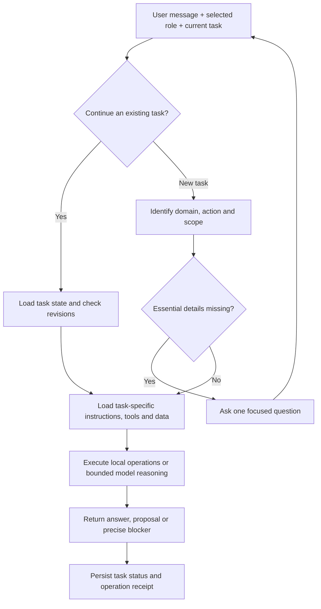

# Three-assistant architecture proposal

Date: November 3, 2026
Status: **Superseded by the [single-agent skill catalog](single-agent-skill-catalog-plan.md). The three-role implementation and workflow switch have been removed.**

This proposal covers the Trainer, Data Scientist and Nutritionist. It proposes a shared task coordinator with small, task-specific instructions, tools and data. It does not propose replacing the selected model, adding three simultaneous model calls, or buying external services.

## 1. What the user should experience

- Ask naturally, including typos and short follow-ups. The application identifies the task and retrieves the relevant information.
- Small changes stay small. Swapping two sessions does not initiate program design or reread all historical workouts.
- Specific questions inspect the specified sessions, metrics and dates. Larger searches happen when the question requires them.
- “Are you working?”, “change it now”, and “what about tomorrow?” continue the current task with its known scope.
- An action is described as saved only after the application confirms persistence. Failed or pending actions retain an accurate status.
- Complex planning remains conversational. The system remembers answered questions and asks only for information that is still necessary.

## 2. Recommended architecture

The coordinator is primarily application code. It uses explicit references, selected UI items and existing task state first. Clear cases take a direct local path. Ambiguous natural language gets one small structured interpretation request.

The interpreter returns fields such as domain, action, session references, dates, requested changes and unresolved details. The application resolves those references against actual records and validates the result. Do not trust a model's confidence score or guessed IDs as proof of a match.

Only the necessary specialist runs. The three roles share task storage, record access, validation, publication services and usage accounting. They receive different domain instructions. Existing model/provider selection remains unchanged during the first rollout so comparisons are meaningful.

## 3. Task catalog and minimum context

Each task definition specifies required fields, optional fields, data queries, tools, validation, write policy, completion conditions and cost limits.

| Specialist / task | Load initially | Expand only when needed |
|---|---|---|
| Trainer: swap or move sessions | Selected sessions, resolved dates, relevant neighboring commitments, recovery rules and versions | Relevant restrictions or conflicting sessions; never the whole program snapshot |
| Trainer: edit duration, interval or exercise | Selected prescription, exact requested change, applicable calibration and restrictions | Recent tolerance or workload if the change increases demand |
| Trainer: record feedback | Selected session, current feedback and linked activity references | The named activity if linking or verifying completion |
| Trainer: explain a session | That session, its purpose and current training block | Relevant recent training or recovery if asked why it was prescribed |
| Trainer: review a week | That week's sessions, relevant adjacent days, recovery and recent workload summaries | The specific records behind a flagged concern |
| Trainer: create/revise a program | Goals, availability, equipment, calibration, restrictions, commitments and calculated historical summaries | Specific records needed to resolve uncertainty; detailed sessions generated only for the necessary horizon |
| Data Scientist: lookup or summary | Requested metrics, filters, period, units and source coverage | Broader scope only if requested or needed to resolve an explicit reference |
| Data Scientist: compare activities | Named activity IDs and requested measurements | Relevant streams, laps or route matching only when required by the question |
| Data Scientist: plot or refine a plot | Metric, date range, axes, saved plot specification and calculated results | Catalog metadata if a metric is unknown; source records for a specific drill-down |
| Data Scientist: investigate/explain | Selected observations, computed comparisons and limitations | Bounded additional queries selected to answer the actual question |
| Nutritionist: log food | Described foods, portions, preparation, meal/date and pending clarification | Food lookup or image analysis when necessary; previous meal reference for an explicit correction |
| Nutritionist: correct a meal | Identified saved meal/items, revisions and requested correction | Other meals only when the correction explicitly refers to them |
| Nutritionist: daily balance | Selected day's totals, applicable targets and missing-nutrient flags | Relevant logged meals when asked to explain a discrepancy |
| Nutritionist: targets or nutrition planning | Current goal, targets, body measurements, dietary constraints and relevant activity summaries | Longer trends or training demands when they affect the requested plan |
| Any role: status/help | Current task status or relevant capability description | No automatic health-history retrieval |

An edit is classified by its effect, not just its wording. Changing 3 repetitions to 10 may require a progression check. A date-only swap can still need a recovery-spacing check. These checks stay narrow and local.

Explicit cross-sport swaps can be dated exceptions to recurring sport/day preferences. Preview states that exception. It does not silently change the weekly template or override fixed commitments, completion status, revision checks, publication ownership or recovery protections.

## 4. Task memory: separate working state from chat history

Store task state server-side, with a stable ID returned to the interface. Do not depend on replaying long chat history or searching assistant prose to reconstruct a pending action.

A task records:

- Domain, action, original request and current requested changes.
- Resolved record IDs, source dates, desired destination dates and user timezone.
- Origin timestamp and the absolute dates resolved from “today” or “tomorrow”.
- Missing fields, selected context references and source revisions.
- Proposal, authorization state, operation ID, save receipt and precise failure/blocker.
- Status: interpreting, awaiting information, ready for review, applying, completed, blocked or cancelled.

Continue a compatible task on a short follow-up. A genuinely new request gets its own task; it does not inherit old write authorization. Preserve unfinished tasks when switching roles, but resume only an explicitly referenced or unambiguous task. Ask which task when necessary.

Freeze relative dates when the task is created. Crossing midnight must not silently shift a pending swap. Recheck record versions at Save. If records changed, explain the change and refresh the affected proposal. A repeated Save returns the original receipt rather than applying the swap twice.

## 5. Instructions and tools loaded for each task

Use a short shared core: grounded facts, source/coverage limitations, date handling, accurate action status and user language. Add only the selected role's task instructions and a small permitted tool set.

Examples:

- Scheduling: find sessions, validate arrangement, prepare/save the approved change.
- Session editing: inspect the selected prescription and validate the requested edit.
- Plotting: discover a metric if needed, query its data, construct/refine the plot.
- Food logging: identify foods, resolve portions, look up nutrients, save using existing receipts.
- Full training planning: the broader planning workflow, calibration, progression and review rules.

Tool availability is enforced by the backend. Omitting a tool description is not an authorization control. All writes continue through validated application services. Imported text and tool results remain data, never permission to perform an action.

Do not load training-planning instructions for meal logging or a ride comparison. Do not load food schemas or chart catalogs for a two-session swap.

## 6. Data access and calculations

Create bounded task-specific queries and response shapes. Fetch the required columns/rows directly rather than reading a full plan and shrinking its JSON afterward.

- Filter by record IDs, local dates, sport and requested fields before serialization.
- Compute totals, trends, coverage and comparisons locally using the existing calculation services.
- Return units, source dates, coverage, missingness and revision metadata with results.
- Keep chart points and full artifacts in the application. Give the model calculated summaries and selected evidence; allow an explicit bounded drill-down when detailed interpretation requires it.
- Exclude raw database JSON, duplicate parsed copies, unrelated review snapshots and unused catalogs from model requests.
- Cache reusable summaries with keys that include filters, timezone, source revisions and relevant calculation version. Invalidate when source data changes.

A summary must not hide evidence needed for the answer. For example, investigating interval fade may require the selected intervals or stream section, not simply whole-ride minimum and maximum power. Route comparison requires route-specific evidence; ordinary ride comparison does not automatically require GPS matching.

## 7. Model calls, token budgets and speed

These are proposed initial ceilings to validate during a pilot, not measured performance promises. Calls and token totals include interpretation, tool rounds and answer generation for the whole task turn.

| Task class | Expected model calls per turn | Initial total input-token ceiling | Initial output-token allowance |
|---|---:|---:|---:|
| Task status, exact stored total, structured selection | 0 | 0 | 0 |
| Clear targeted edit or swap | 0; up to 1 for interpretation | 3,000 | 500 |
| Food log/correction | 0–1; image handling measured separately | 4,000 | 1,000 |
| Focused explanation, comparison or chart | 1–2; clear preset charts may use 0 | 6,000 | 1,000 |
| Full planning or substantial investigation | 1–3; larger work split into explicit stages | 16,000 | 3,000 |

Output allowances must account for necessary structured data. Track provider-reported reasoning tokens separately and include them in total usage; visible answer length alone is not a cost measure. If a provider does not supply usage, label estimates as estimates. Use a model-compatible token counter where available and a conservative estimate otherwise.

Before every model request, check the remaining task budget and serialized size. An exact repeated tool call returns the existing result or ends the loop. Proposals, refusals and focused clarification questions end that stage. Stop on budget exhaustion with a truthful status; do not silently retry, switch to a paid provider, or omit essential evidence to squeeze through a limit.

For complex tasks, the budget may be expanded through an explicit next stage. Do not impose a single tiny tool-round limit that prevents legitimate dependent queries.

Measure local task execution separately from model/network latency. Target p95 under one second for ordinary local actions on the user's machine after references are resolved. For model-driven cases, compare median and p95 time against the same model, dataset and representative requests. Show an immediate acknowledgement and meaningful progress for longer work. Avoid redundant classifier calls on every continuation.

## 8. Review and save behavior

Recommended default: preserve the application's existing product rules while changing orchestration.

- Training edits and plan activation retain their existing review/Save controls. The coordinator leads directly to the correct proposal.
- Clear consumed-food reports retain the current automatic logging behavior and duplicate protection.
- Nutrition target changes retain the existing target review/save rules.
- Garmin publication remains a separate, accurately reported action. A local edit does not mean the remote workout was updated.
- “Are you working?” reads status and cannot authorize a write.

Allowing a conversational “apply it” to save a pending training proposal is a separate product decision. If desired later, it must bind to one current proposal and valid revisions, then return a durable receipt. This proposal does not introduce that change implicitly.

## 9. Plugins and shared capabilities

No new plugin is required for the first implementation. Existing local Garmin, training, charting and nutrition services supply the necessary capabilities.

Organize those services behind reusable task interfaces. Consider a plugin/MCP integration later when an external service is genuinely needed or another application must reuse these capabilities. Any such integration should expose only relevant tools on demand. Installing plugins or describing all plugin tools on every turn would not fix excessive context or missing task state.

## 10. Rollout and review checkpoints

1. **Contracts and baseline:** define task schemas, write policies and representative conversations. Record calls, tokens, context sizes and timing with the existing selected provider. Separate existing test failures from new regressions.
2. **Shared task state and router:** implement durable task IDs, continuation, frozen dates, reference resolution, completion receipts and the small interpretation fallback. Keep current specialist flows behind adapters.
3. **Trainer pilot:** implement swap/move, one-session editing and feedback first. Then week review and full program planning. Validate that small edits never invoke the planning workflow.
4. **Data Scientist:** add scoped lookups, comparisons, plots and explicit investigation stages. Preserve existing chart references and missing-data behavior.
5. **Nutritionist:** connect logging, corrections, daily totals and target/planning flows to shared task state without losing portions, meal/date associations or retry receipts.
6. **Controlled rollout:** compare accuracy, cost and speed by task class; enable new handlers gradually. Retain a rollback switch. Keep a task on one handler version through completion or require a fresh preview if migration is unsafe.

The first review checkpoint is this design. The next checkpoint is the task contracts and baseline results, before replacing existing flows. Trainer pilot results are reviewed before broadening to the other two specialists.

## 11. Acceptance criteria

- The exact strength/endurance swap, its typos, “are you working?” and “change it now” stay attached to the same two sessions and absolute dates. Save changes both dates once. A retry cannot reverse the completed swap.
- Swaps cover same/cross sport, more than one session per day, differing durations, explicit exceptions, midnight/DST, stale revisions, fixed events, recovery conflicts and published workouts.
- Single-session edits load that session and necessary checks, without full plan/history context. Larger progression changes obtain the relevant tolerance evidence.
- Full planning retains goals, availability, calibration, constraints and answered questions across turns and app restarts. Narrow context does not degrade the final plan.
- A question about two rides reads those rides. A monthly chart reads that period. Plot refinements retain axes/filters, with correct missingness and no invented measurements.
- Nutrition follow-ups preserve meal/date, foods and portions; corrections change the intended saved item; retries cannot duplicate a log. Targets use the proper recorded inputs.
- Mixed requests create explicit tasks. Independent reads may run together; dependent writes remain ordered. Partial success is reported and not silently repeated.
- English, Hebrew, typos, ambiguous references, cancellation, role switching, provider errors and application restarts are covered.
- Every task has measured model calls, total usage, elapsed time and final status. Logs omit health content, credentials and raw prompts.
- There are no unauthorized writes, silent loss of necessary context or new regressions in the agreed baseline. Budget/latency targets are reported as measured results, not assumed successes.

## 12. Decisions for user review

Recommended first version: one shared coordinator; three specialist instruction sets; direct local execution for clear tasks; one small interpretation call when needed; existing review/save rules; no new plugins; staged rollout starting with Trainer.

The main decision to discuss separately is whether clear conversational approval should eventually save a pending training edit, instead of requiring the visible Save button. That change is optional and does not block the efficiency redesign.

Existing implementation changes from the earlier bug-fix work remain in the working tree. This planning request creates only this document; it does not complete, deploy or authorize the broader redesign.
